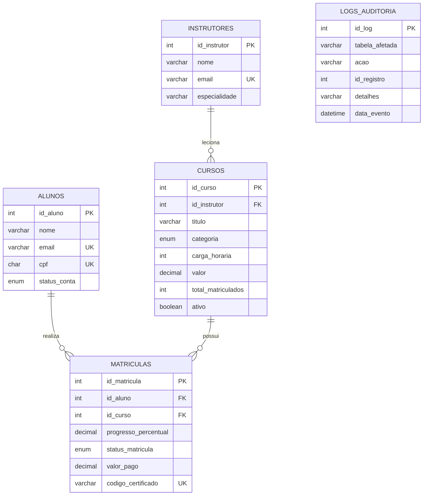

#  Modelagem Relacional Avançada em MySQL — TecnoCapacita DB

Projeto completo de banco de dados relacional em **MySQL 8+** desenvolvido por **João Pedro Araujo dos Santos** ([`@joaopedro-labs`](https://github.com/joaopedro-labs)) para gerenciar instrutores, cursos, alunos, matrículas, emissão automatizada de certificados e auditoria de alterações.

##  Diagrama Entidade-Relacionamento (MER)

##  Recursos de Banco de Dados Implementados

1. **[`sql/01_schema_tabelas.sql`](./sql/01_schema_tabelas.sql)** — Modelagem normalizada com `PRIMARY KEY`, `FOREIGN KEY`, `UNIQUE`, `CHECK` constraints e indexação (`InnoDB`).
2. **[`sql/02_triggers_auditoria.sql`](./sql/02_triggers_auditoria.sql)** — 3 **Triggers** automatizadas:
   - `trg_after_insert_matricula`: Incrementa o contador `total_matriculados` no curso e registra log de auditoria.
   - `trg_before_update_progresso`: Ao atingir `100%` de progresso, muda automaticamente o status para `'Concluido'` e gera o código único do certificado (`TC-<curso>-<aluno>-<data>`).
   - `trg_after_update_preco_curso`: Registra histórico na tabela `logs_auditoria` sempre que o valor de um curso é alterado.
3. **[`sql/03_views_relatorios.sql`](./sql/03_views_relatorios.sql)** — 2 **Views** gerenciais:
   - `vw_desempenho_cursos`: Consolida total de alunos, concluintes, média de progresso e receita financeira por curso.
   - `vw_painel_alunos`: Visão unificada do progresso e certificados emitidos por aluno.
4. **[`sql/04_stored_procedures.sql`](./sql/04_stored_procedures.sql)** — 2 **Stored Procedures**:
   - `sp_realizar_matricula(id_aluno, id_curso, desconto_pct)`: Valida se o curso está ativo, calcula o desconto percentual e efetua a matrícula.
   - `sp_atualizar_progresso(id_matricula, novo_progresso)`: Valida limites (`0` a `100%`) e atualiza o andamento do aluno.
5. **[`sql/05_dados_teste_e_consultas.sql`](./sql/05_dados_teste_e_consultas.sql)** — Script completo de carga inicial e consultas de validação.
